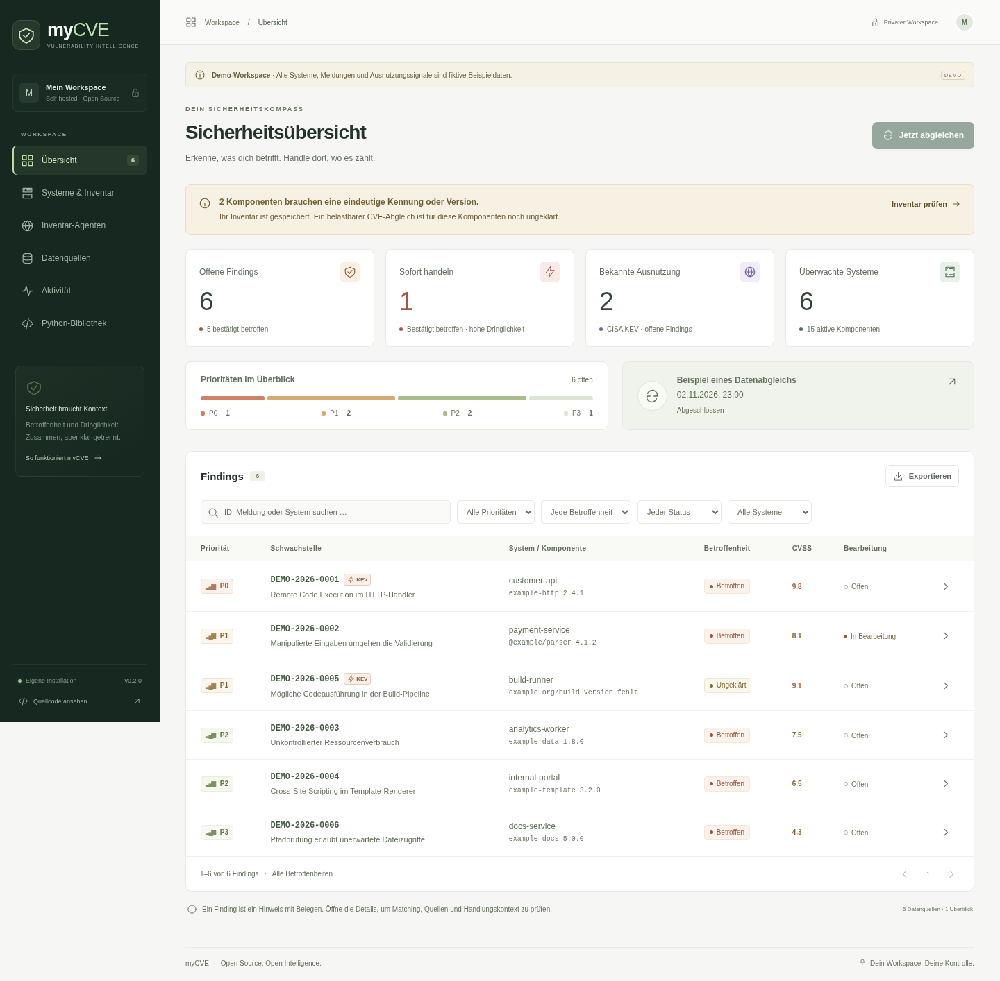
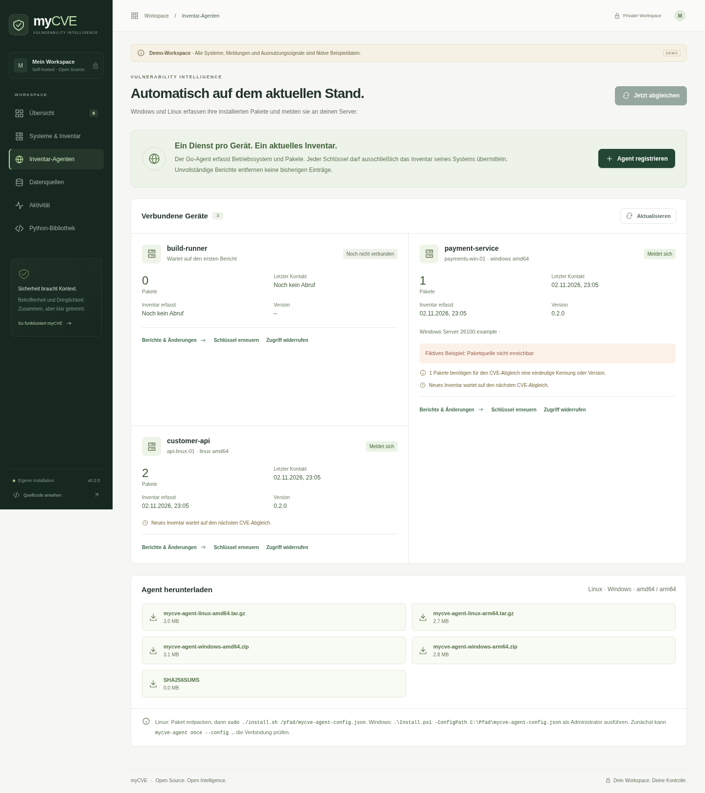

# myCVE

[](https://github.com/DerAlex90/myCVE/actions/workflows/ci.yml)
[](LICENSE)


**Dein Inventar. Deine Schwachstellen. Klare Prioritäten.**

myCVE verbindet eine eigenständig verwendbare Python-Bibliothek mit einem selbst betreibbaren CVE-Tracker. Importiere eine SBOM, prüfe konkrete Installationen und verfolge Betroffenheit, Dringlichkeit und Bearbeitung mit nachvollziehbaren Quellen.

**Version 0.2 ergänzt den Go-Inventar-Agenten für Linux und Windows:** Betriebssystem und installierte Pakete erfassen, geschützt an den Server senden, Änderungen speichern und im Web anzeigen. Linux-systemd- und native Windows-Dienste sowie fertige amd64-/arm64-Pakete sind enthalten.

Python 3.12+ · FastAPI · PostgreSQL / JSONB · Celery / Redis · React / TypeScript · Docker Compose / Caddy · MIT

[Server starten](#mit-docker-starten) · [Agent installieren](agent/README.md) · [API](docs/api.md) · [Architektur](docs/architecture.md) · [Mitentwickeln](CONTRIBUTING.md)



## Enthalten

- CycloneDX-JSON- und CSV-Import mit atomarer Validierung, stabilen Komponentenreferenzen und Inventarhistorie.
- OSV-Paketabgleich einschließlich Batch-Paginierung und vollständiger Meldungsdetails.
- CVE-Program- und NVD-Anreicherung sowie NVD-Kandidatensuche für konkrete CPEs.
- CISA-KEV-Priorisierung mit offiziellem GitHub-Spiegel als Ausweichquelle.
- Öffentliche BSI-CSAF-Hinweise über die offiziellen CERT-Bund-Provider-Metadaten. Große ROLIE-Feeds werden gestreamt; ausschließlich WHITE/CLEAR wird gespeichert.
- Findings je Installation, CVE/GHSA/OSV-Aliase, Begründungen, Quellenbelege, Rohdaten, Revisionen und Änderungshistorie.
- Getrennte Betroffenheit (`affected`, `not_affected`, `unknown`), Priorität (`P0`–`P3`) und Bearbeitung.
- Filter, Suche, CSV-Export, Verantwortliche, Systemkritikalität, Quellenprotokolle und mobile Oberfläche.
- Regelmäßiger Abgleich bekannter Meldungen und des Inventars, standardmäßig alle sechs Stunden.
- API-Schlüssel, restriktive Standardkonfiguration und ein ausdrücklich fiktiver Demo-Modus.
- Gerätespezifische Agent-Schlüssel, lokale Wiederholungsdatei, Paketänderungsverlauf und Schutz vor unvollständigen oder veralteten Inventarberichten.

## Mit Docker starten

Voraussetzungen: Docker mit Compose v2 und Python zum Erzeugen der lokalen Konfiguration.

```bash
git clone https://github.com/DerAlex90/myCVE.git
cd myCVE
python scripts/configure.py
docker compose up --build -d
```

Öffne **http://localhost:8080** und melde dich mit `MYCVE_API_KEY` aus der erzeugten `.env` an. Das Konfigurationsskript erzeugt zufällige Schlüssel, setzt lokale Dateirechte und überschreibt keine vorhandene Konfiguration.

1. Unter **Systeme & Inventar** ein System mit Erreichbarkeit und Kritikalität anlegen.
2. `fixtures/inventory.cdx.json`, `fixtures/inventory.csv` oder das eigene Inventar importieren.
3. **Jetzt abgleichen** starten. Unter **Aktivität** den Stand jeder Quelle prüfen.
4. Findings öffnen, Belege lesen und die Bearbeitung dokumentieren.

PostgreSQL und Redis sind ausschließlich im Compose-Netz erreichbar. Die Weboberfläche bindet standardmäßig an Loopback. Für eine eigene Domain und HTTPS siehe [Betrieb](docs/operations.md).

Ein NVD-API-Schlüssel ist optional (`MYCVE_NVD_API_KEY` in `.env`). Ohne Schlüssel dauern größere Abgleiche durch die eingehaltene Abrufbegrenzung länger.

## Geräte automatisch melden lassen

1. Unter **Systeme & Inventar** ein System anlegen.
2. Unter **Inventar-Agenten** dieses System registrieren und die einmalig ausgegebene Gerätekonfiguration herunterladen.
3. Dort das passende Linux-/Windows-Paket herunterladen und die Konfiguration auf genau dieses Gerät übertragen.
4. Zunächst `mycve-agent once --config /pfad/mycve-agent-config.json` testen; anschließend den enthaltenen Dienst-Installer verwenden.

Linux: `sudo ./install.sh /pfad/mycve-agent-config.json`. Windows: `.\Install.ps1 -ConfigPath C:\Pfad\mycve-agent-config.json` als Administrator. Der Docker-Build erstellt alle vier Agent-Pakete und stellt sie authentifiziert in der Oberfläche bereit. [Vollständige Agent-Anleitung](agent/README.md).

| Plattform | Architektur | Erfassung | Dienst |
| --- | --- | --- | --- |
| Linux | amd64, arm64 | dpkg, RPM, APK und konfigurierte SBOMs | systemd oder eigener Supervisor |
| Windows | amd64, arm64 | Registry, Appx, Betriebssystem und konfigurierte SBOMs | Windows Service Control Manager |

Die Pakete enthalten Installer, Dokumentation und Lizenzen. Ein `SHA256SUMS`-Manifest liegt bei den Server-Downloads. Der [CI-Workflow](https://github.com/DerAlex90/myCVE/actions/workflows/ci.yml) erzeugt zusätzlich Agentenpakete und Python-Distributionen als herunterladbare Artefakte. Die lokal ausgeführten Prüfungen und die Grenzen des Windows-Nachweises stehen unter [Validierung](docs/validation.md).

Der Agent sendet ausschließlich an den konfigurierten myCVE-Server; der Server führt die externen CVE-Abfragen durch. Der Geräteschlüssel kann nur das zugeordnete Inventar übermitteln und ist separat widerrufbar. Der Workspace-Schlüssel gehört nicht auf Geräte. Vollständige Berichte ersetzen nur ihre eigene Erfassungsquelle; fehlgeschlagene Quellen und manuelle SBOMs bleiben erhalten. Windows-Anwendungsnamen oder RPM-Pakete werden ohne eindeutige Kennung nicht als sicher abgeglichen ausgegeben. Die Oberfläche zeigt solche Lücken ausdrücklich an.

Geändertes Agent-Inventar wird vom Scheduler zum nächsten globalen Abgleich vorgemerkt. Der Scheduler prüft minütlich und bündelt Anfragen mit einer Mindestpause von fünf Minuten zwischen Scans. Bestehende Findings werden bereits beim Import neu bewertet.



## Lokale Demo

Voraussetzungen: Python 3.12+, [uv](https://docs.astral.sh/uv/) und Node.js 24+.

```bash
uv sync --frozen --extra server --extra dev
cd frontend
npm ci
npm run build
cd ..
uv run mycve demo
```

Öffne **http://127.0.0.1:8000**. Alle Demo-Systeme, Paketnamen, Meldungen und Ausnutzungssignale sind erfunden. Die Demo verwendet `demo.db`, benötigt keinen Schlüssel und startet ausschließlich auf Loopback. Echte Feed-Scans sind im Demo-Modus gesperrt. Die Demo-Datenbank bleibt zwischen Starts erhalten.

Für eine lokale echte Installation:

```bash
MYCVE_ALLOW_UNAUTHENTICATED=true MYCVE_TASK_MODE=inline uv run mycve serve
```

Dieser Entwicklungsmodus bindet ebenfalls standardmäßig an Loopback. Für den dauerhaften Betrieb mit Hintergrundjobs die Compose-Installation verwenden. Für Frontend-Entwicklung: `npm run dev` im Verzeichnis `frontend`; Vite leitet API-Anfragen an Port 8000 weiter.

## Die öffentliche Python-Bibliothek

Die Kernbibliothek benötigt weder FastAPI noch Datenbank, Redis oder Netzwerkzugriff. Sie wird aus dem Quellcode installiert; das Projekt behauptet keine bereits erfolgte Veröffentlichung auf PyPI.

```bash
pip install .
```

```python
import json
from pathlib import Path
from mycve import Component, match_osv, prioritize

advisory = json.loads(Path("fixtures/advisory.json").read_text())
component = Component(
    name="example-http", ecosystem="PyPI", version="2.4.1"
)

result = match_osv(component, advisory)
priority = prioritize(
    result.status, kev=True, cvss=9.8,
    exposure="internet", criticality="high",
)
print(result.model_dump())
print(priority.model_dump())
```

Oder vollständig offline über die CLI:

```bash
mycve match --component fixtures/component.json --advisory fixtures/advisory.json
```

Die API der Bibliothek exportiert `Component`, `MatchResult`, `match_osv`, `match_cve`, `match_nvd` und `prioritize`. Die Server-Komponenten installiert `pip install '.[server]'` zusätzlich. Releases lassen sich mit `python -m build` als Wheel und Quelldistribution erstellen.

## Inventarformat

Unterstützt werden CycloneDX JSON 1.4–1.7 inklusive verschachtelter `components` und CSV mit folgenden Spalten:

```csv
name,version,ecosystem,purl,cpe,vendor,platform,ref
requests,2.31.0,PyPI,pkg:pypi/requests@2.31.0,,,,requests
```

`name` ist erforderlich. Nutze bei Paketen bevorzugt eine PURL. Eine angegebene Version darf der PURL nicht widersprechen. `ref` bzw. CycloneDX `bom-ref` identifiziert dieselbe Installation über Versionswechsel hinweg. Ohne Referenz bleiben gleichzeitig installierte Versionen getrennte Installationen. Bei Debian-PURLs muss die Distribution angegeben sein, z. B. `?distro=debian-12`.

Beim Ersetzen eines Inventars werden fehlende Komponenten inaktiv; vorhandene Findings und deren Historie bleiben erhalten. Unvollständige oder ungültige Dateien ändern das Inventar nicht. Ein Import bewertet bestehende Findings unmittelbar neu; neue Meldungen werden beim nächsten Scan ermittelt.

## Matching und Priorität

| Dimension | Bedeutung |
| --- | --- |
| Betroffenheit | Exakte Paket-/Produktidentität und auswertbare Versionen; fehlende Angaben bleiben ungeklärt. |
| Dringlichkeit | KEV, technische Schwere, Erreichbarkeit und Systemkritikalität. |
| Bearbeitung | Offen, in Bearbeitung, Risiko akzeptiert oder erledigt; ändert die ermittelte Betroffenheit nicht. |

`P0` erfordert bestätigte Betroffenheit und KEV plus Internet-Erreichbarkeit oder hohe Kritikalität. Ungeklärte Findings erhalten kein `P0`. Der dokumentierte Prioritätswert ist eine transparente Heuristik, keine Exploit-Wahrscheinlichkeit. Die genaue Formel und konservative Grenzen stehen in [Matching](docs/matching.md).

## Daten und Datenschutz

Inventar, Entscheidungen und Quellenrevisionen werden in der eigenen Datenbank gespeichert. **Für Live-Abgleiche sendet myCVE Paketnamen, Ökosysteme und Versionen an OSV sowie CPEs und CVE-IDs an NVD.** CVE- und BSI-Dokumente werden von den jeweiligen öffentlichen Quellen abgerufen. Eigentümer, Systemnamen und Notizen werden diesen Quellen nicht übermittelt. Die Offline-Bibliothek hat keinen Netzwerkzugriff.

myCVE übernimmt Quelldaten und Zeitstände unverändert als JSON-Werte. Die SHA-256-Prüfsumme bezieht sich auf kanonisch serialisiertes JSON, nicht auf die ursprünglichen HTTP-Bytes. Die tatsächliche Quell-URL, erster Abruf, letzter erfolgreicher Abruf und Quelländerung bleiben erhalten. HTTPS wird geprüft; OpenPGP-Signaturen von CSAF-Dokumenten werden in dieser Version noch nicht verifiziert.

## API und Dokumentation

- [Architektur und Datenmodell](docs/architecture.md)
- [Matching, Konfidenz und Grenzen](docs/matching.md)
- [Betrieb, Backup und Wiederherstellung](docs/operations.md)
- [Quellen und Nutzungsbedingungen](docs/sources.md)
- [API-Beispiele](docs/api.md)
- [Go-Agent, Konfiguration und Dienstinstallation](agent/README.md)
- [Ausgeführte Validierung](docs/validation.md)
- [Mitentwickeln](CONTRIBUTING.md) · [Sicherheit](SECURITY.md) · [Änderungen](CHANGELOG.md)

Die OpenAPI-Spezifikation ist unter `/api/openapi.json` mit demselben Bearer-Schlüssel verfügbar. `/health` liefert eine einfache Datenbank-Lebendprüfung. Manuelle Einmalabgleiche ohne Oberfläche: `mycve sync` mit derselben Serverkonfiguration.

## Qualität prüfen

```bash
uv sync --frozen --extra server --extra dev
uv run ruff check src tests scripts migrations
uv run ruff format --check src tests scripts migrations
uv run mypy src/mycve
uv run pytest
cd frontend
npm ci
npm run lint
npm run build
npx playwright install chromium
npm run test:e2e
```

Die Tests decken Versionsgrenzen, Ökosysteme, Alias-Brücken, Revisionen, widersprüchliche Aussagen, atomare Importe, Authentifizierung, Quellenfehler und Browser-Workflows ab. Der Browser-Test prüft auch die mobile Ansicht und automatisierte WCAG-AA-Regeln. PostgreSQL-Integrationstests verwenden mit `MYCVE_TEST_POSTGRES_URL` einen isolierten, nach dem Test entfernten Schema-Namensraum.

Für den Agenten: `cd agent && go test ./... && go vet ./...`. `go run ./cmd/package --out ../dist/agent` erstellt die Downloads. `uv run python scripts/smoke_agent.py` prüft den gebauten Linux-Agenten gegen einen temporären echten HTTP-Server, einschließlich Schlüsselwiderruf und Wiederaufnahme. Ein isolierter nativer Windows-Diensttest ist für den Windows-CI-Runner hinterlegt.

## Projektstruktur

```text
src/mycve/core/   Unabhängige Python-Bibliothek für Identität, Matching und Priorität
src/mycve/server/ API, Inventar, Quellenadapter und Hintergrundjobs
agent/           Go-Datensender, Paketquellen und Dienst-Installer
frontend/        React-Oberfläche und Browser-Workflows
migrations/      Versionierte Datenbankänderungen
tests/           Fachliche Tests und Server-Integration
docs/            Architektur, API, Betrieb und Quellen
fixtures/        Kleine Beispiele für Importe und Offline-Matching
```

## Bewusste Grenzen von 0.2

Diese Version ist ein funktionsfähiger Release für einen gemeinsamen, vertrauenswürdigen Workspace mit getrennten Agent-Schlüsseln. Vollständige CPE-AND/NOT-Konfigurationen über mehrere Installationen, Git-Commit-Ranges, automatische CPE-Zuordnung für beliebige Windows-Anwendungen, universelle Distributions-Backport-Erkennung, OpenPGP-Verifikation, Mehrbenutzer-Rollen, Benachrichtigungen und EPSS sind noch nicht enthalten. Solche Matching-Fälle bleiben ungeklärt. Der Agent deckt Linux-Paketmanager, Windows-Registry/Appx und explizite SBOMs ab; portable Software und offline gespeicherte Windows-Benutzerprofile werden nicht vollständig erfasst.

Der Abgleich lädt gezielt bekannte und zum Inventar passende Meldungen. Er spiegelt nicht den gesamten globalen CVE-/NVD-Datenbestand. Änderungen an bekannten Meldungen werden bei jedem Scan erneut abgerufen.

## Lizenz

Der Programmcode steht unter der [MIT-Lizenz](LICENSE). Für importierte Meldungen gelten weiterhin die Bedingungen der jeweiligen Datenquelle; siehe [Quellen](docs/sources.md).
