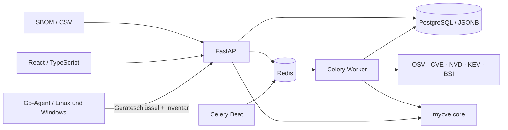

# Architektur

myCVE ist ein modularer Monolith. Der reine Kern unter `src/mycve/core` kennt weder Netzwerk noch SQLAlchemy. Die optionalen Server-Module enthalten API, Persistenz, Quellenadapter und Hintergrundjobs. Die React-Anwendung spricht dieselbe API wie externe Clients.

## Datenmodell

| Tabelle | Zweck |
| --- | --- |
| `assets` | System, Verantwortung, Umgebung, Erreichbarkeit, Kritikalität |
| `installations` | Konkrete Komponente, Version/PURL/CPE, stabile Identität, Aktivität |
| `product_identity_cache` | Geräteübergreifende CPE-Produktentscheidungen und kurzfristige CVE-Suchergebnisse mit Ablaufzeit |
| `vulnerabilities` | Interne Identität und aktuelle zusammengefasste Beschreibung/Metriken |
| `aliases` | Eindeutige Zuordnung von CVE-, GHSA-, OSV- oder anderen IDs |
| `source_records` | Originales JSON, Revision, Prüfsumme, Zeitstände und tatsächliche URL |
| `findings` | Verbindung Installation–Schwachstelle mit Betroffenheit und Entscheidung |
| `finding_events` | Vorher-/Nachher-Zustände bei fachlichen Änderungen |
| `scan_jobs` | Status, Quellenfehler, Umfang und Abschluss eines Abgleichs |
| `agents` | Ein Gerät je Asset, Schlüsselhash, Gerätebindung, letzter Kontakt, Host/Collector-Status und vorgemerkter Abgleich |
| `inventory_snapshots` | Unveränderlicher Bericht, Erfassungs-/Empfangszeit, Prüfsumme und Änderungszahlen |
| `inventory_changes` | Hinzugefügte, aktualisierte und entfernte Pakete mit Vorher/Nachher |

Eine Installation kann mehrere Findings haben. Die Kombination aus Installation und interner Schwachstelle ist eindeutig. Eine Meldung ohne CVE-ID bleibt über ihre OSV-/GHSA-ID abbildbar. Werden zuvor getrennte Datensätze später durch einen Alias verbunden, werden sie einschließlich ihrer Quellen und Ereignisse zusammengeführt.

## Ablauf eines Scans

1. Einen Job nach Inventaränderungen, fälligen Produktprüfungen oder regulärem Zeitplan automatisch persistieren und über Redis an Celery übergeben.
2. Über eine dedizierte PostgreSQL-Verbindung einen globalen Advisory Lock halten.
3. Standardisierte Paketidentitäten übernehmen oder Hersteller/Produkt automatisch gegen den CPE-Katalog prüfen. Originalinventar und nachvollziehbare Zuordnung getrennt speichern. Nicht eindeutige Produkte und Abruffehler automatisch erneut vormerken. Für konkrete CPEs NVD-Kandidaten suchen; Suchergebnisse eine Stunde wiederverwenden, damit Fortsetzungen großer Inventare bereits erledigte Abfragen nicht wiederholen. Für Pakete OSV-Batches einschließlich aller Seiten abfragen und vollständige Meldungen laden.
4. Neue und bereits bekannte CVEs über CVE Program und NVD aktualisieren.
5. Einen vollständigen KEV-Katalog validieren und die KEV-Signale erneuern.
6. Öffentliche BSI-Feeds aus den Provider-Metadaten entdecken, streamen, passende Dokumente abrufen und deren TLP-Einstufung prüfen.
7. Das aktuelle Inventar erneut laden, Matching ausführen, Priorität bestimmen und fachliche Änderungen protokollieren.
8. Den Job als erfolgreich, teilweise erfolgreich oder fehlgeschlagen abschließen.

Ein Quellenfehler bewirkt keine pauschale Entwarnung. Frühere Quellen bleiben erhalten und der Fehler ist im Scan-Protokoll sichtbar. Eine vollständige negative OSV-Versionsabfrage darf einen alten OSV-Treffer zurücknehmen. Unterschiedliche bestätigte Aussagen werden als Konflikt dargestellt.

Der Worker verarbeitet standardmäßig einen Scan gleichzeitig. Ein abgebrochener Job blockiert nach dem zweistündigen Worker-Zeitlimit plus fünf Minuten Karenzzeit keine neuen Abgleiche mehr. Wiederholte identische Bewertungen erzeugen kein neues Finding und kein neues fachliches Ereignis.

## Auslieferung

Das Docker-Image baut das Frontend in einer Node-Stufe und installiert das Python-Paket mit gesperrten Server-Abhängigkeiten. FastAPI liefert die fertigen Frontend-Dateien aus. Caddy übernimmt Kompression und optional HTTPS. API und Worker laufen als UID 10001. PostgreSQL und Redis haben keine veröffentlichten Ports.

SQLite ist für lokale Entwicklung und die Demo vorgesehen. Der Mehrprozessbetrieb verwendet PostgreSQL, Redis und versionierte Alembic-Migrationen. Weitere Schemaänderungen benötigen jeweils eine neue Migration.
